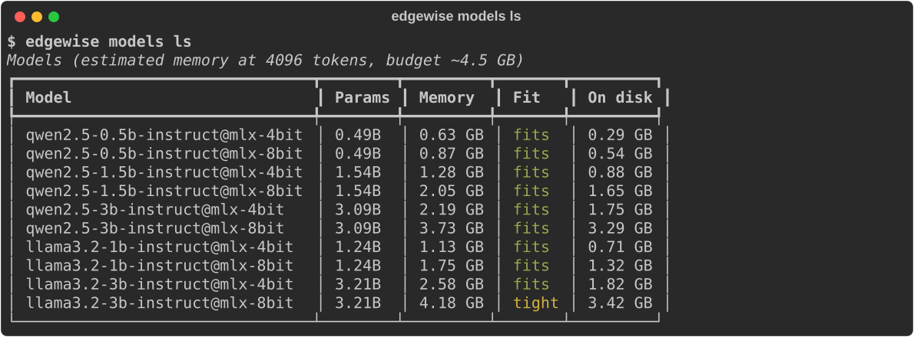

# Edgewise

**Run the right LLM, the right way, on the hardware you have.**

Edgewise is a toolkit for running large language models on everyday devices (laptops, edge boxes, in-vehicle computers) and reaching for a bigger model only when it is actually needed. It measures real models on your own machine and uses those measurements to answer three questions:

| | Question | Command |
|---|---|---|
| **Advisor** | Which model variant is the best fit for this device and this task? | `edgewise advise` |
| **Accelerator** | How much faster can it generate without changing its output? | `edgewise bench --decoding …` |
| **Router** | Which requests can stay on the device, and which need a stronger model? | `edgewise route`, `edgewise serve` |



## Status

All five parts are implemented, covered by unit tests, and have now been run on real models on the reference device (Apple A18 Pro, 8 GB RAM).

| Part | Code | Verified on real models |
|---|---|---|
| Bench (speed, memory, task quality) | ✅ | ✅ 8 of the 10 catalog models (the two 3B 8-bit variants do not fit comfortably in 8 GB) |
| Accelerator (speculative + prompt-lookup decoding) | ✅ | ✅ 1.5B and 3B models; text matches standard decoding on 330 of 336 items |
| Advisor | ✅ | ✅ recommendations for all five tasks from measured data |
| Router + local API | ✅ | ✅ on-device cascade (1.5B answering, 3B as escalation); the Claude API tier has only been tested with a stand-in client |
| Reports and charts | ✅ | ✅ generated from the measurements below |

Every number in this README was measured on that device with the commands shown. The full generated report is [results/published/REPORT.md](results/published/REPORT.md).

## Quickstart

Requires Python 3.11+, [uv](https://docs.astral.sh/uv/) and, for running models, an Apple Silicon Mac.

```bash
git clone https://github.com/tanishakarmakar/edgewise.git
cd edgewise
uv sync --extra mlx                 # add --extra cloud --extra serve for the router's cloud tier and API

uv run edgewise info                # this device and its memory budget for models
uv run edgewise models ls           # catalog, estimated memory, what fits
uv run edgewise models pull qwen2.5-0.5b-instruct@mlx-4bit
uv run edgewise bench -m qwen2.5-0.5b-instruct@mlx-4bit --all-tasks
```

Then, once a few models are benchmarked:

```bash
uv run edgewise advise --task tool_calling --memory 4GB --min-score 0.8
uv run edgewise bench -m qwen2.5-3b-instruct@mlx-4bit --all-tasks --decoding prompt_lookup
uv run edgewise route "Summarise this for me: ..." --remote none
uv run edgewise serve               # OpenAI-compatible API on http://127.0.0.1:8080
uv run edgewise report              # tables + charts in results/published/
```

`scripts/bench_all.sh` benchmarks the whole catalog, one model at a time, smallest first.

> Benchmarks load multi-gigabyte models. On an 8 GB machine, close other apps first: Edgewise warns when the system is already swapping and tags those results as unreliable.

## How it works

Everything is built on one foundation: a **backend interface** (MLX today), a **task-based eval suite**, a **bench runner** and a **results store** (DuckDB). The three features only ever read measurements from that store.

### Bench

For one model, the runner checks the memory estimate against the device budget, loads the model, warms it up, measures raw speed at three prompt lengths (time to first token, prefill and decode tokens/s, inter-token latency, peak memory; median and interquartile range over repeats), scores it on the eval tasks, and unloads it even if something fails. Every run records the hardware, library versions, git commit, power source and swap usage.

Eval tasks (84 hand-written items, 12 to 20 per task; still small, so treat score differences of a few points as noise):

| Task | What the model must do | Scoring |
|---|---|---|
| `tool_calling` | Pick the right tool and arguments from a tool list | Exact call match |
| `json_extraction` | Fill requested fields from text | Field-level F1 |
| `grounded_qa` | Answer from a given passage | Contains the answer, else token F1 |
| `short_reasoning` | Arithmetic word problems | Final number |
| `text_edit` | Apply one edit and return the full text | Exact match, else token F1 |

### Advisor

`advise` takes a task, a memory budget and an optional quality floor. It drops variants that do not fit (using the measured peak when there is one), drops those below the floor, keeps the ones on the score/speed Pareto frontier, and picks by preference: `speed`, `quality`, or the default `balanced`, which takes the fastest model whose score is within 0.05 (or one eval item) of the best. It explains the choice against the runner-up and flags weak evidence (few test items, battery power, memory pressure). Variants that have not been benchmarked are listed with the command to benchmark them and are never ranked.

### Accelerator

Speculative decoding with greedy verification: something cheap guesses the next few tokens, and the model checks all of them in a single forward pass and keeps the longest prefix it agrees with. Every emitted token is the model's own choice, so in exact arithmetic the output is the same as normal decoding (on real hardware, near-ties can break differently; see the results).

- **Draft model**: a 0.5B model guesses for a 1.5B or 3B model with the same tokenizer.
- **Prompt lookup**: if the last few tokens already appeared in the prompt, guess what followed them there. No extra model, useful when the output copies the input (editing, extraction, RAG).
- **Cost-aware guess length**: verifying guesses is not free. On the reference device a pass over 9 tokens costs about 3× a pass over 1 (see the results), so guessing only pays when guesses land. Edgewise measures that cost curve per model, tracks how often guesses are accepted, and picks the guess length with the best expected tokens per millisecond, including "don't guess".

The engine is written against a small model interface, so 42 tests check with fake models that accelerated output equals plain greedy output for every proposer and policy.

### Router

For each request, in order:

1. **Hard rules** that nothing overrides: requests marked private, requests containing personal data (email, phone, card, national ID patterns), and requests made offline stay on the device.
2. **Cascade**: answer locally, then escalate only if the answer is empty, is not valid JSON when JSON was asked for, or was generated with low confidence (mean token log-probability below a threshold).
3. If escalation fails, the local answer is returned instead of an error.

The escalation tier is either a larger on-device model or the Claude API; cost is tracked per request, and prompts are never written to the route log. `edgewise report --local A --strong B` replays the cascade at every threshold from stored benchmark results, so the threshold is chosen from data instead of by guess. When there are enough eval items, it is chosen on one half and reported on the other.

`edgewise serve` exposes the router as `POST /v1/chat/completions` (JSON and SSE), so OpenAI-compatible clients work unchanged. Each response carries an `edgewise` object with the route, the reason and the cost.

## Results

Reference device: **Apple A18 Pro, 8 GB RAM**, on mains power, MLX 0.32.4 and mlx-lm 0.32.2, 12 November 2026. Quality is the mean score over 84 hand-written eval items, with greedy decoding. Speed is the median of 5 repeats. The two 3B runs started with 1.1 to 1.5 GB of swap already in use, so their speed may be slightly understated.

### Speed, memory and task quality

| Model | Tokens/s | First token, 1K prompt | Peak memory | Tool calling | JSON | Grounded QA | Reasoning | Text edit |
|---|---:|---:|---:|---:|---:|---:|---:|---:|
| Qwen 2.5 0.5B, 4-bit | 138 | 0.7 s | 1.1 GB | 0.65 | 0.96 | 0.94 | 0.55 | 1.00 |
| Qwen 2.5 0.5B, 8-bit | 88 | 0.8 s | 1.3 GB | 0.80 | 0.97 | 0.81 | 0.60 | 1.00 |
| Llama 3.2 1B, 4-bit | 61 | 2.1 s | 1.5 GB | 0.60 | 0.63 | 0.91 | 0.50 | 0.97 |
| Llama 3.2 1B, 8-bit | 35 | 2.2 s | 2.1 GB | 0.70 | 0.38 | 0.91 | 0.80 | 0.95 |
| Qwen 2.5 1.5B, 4-bit | 46 | 2.8 s | 1.6 GB | 0.95 | 0.96 | 0.93 | 0.45 | 1.00 |
| Qwen 2.5 1.5B, 8-bit | 27 | 3.3 s | 2.3 GB | 0.95 | 0.98 | 0.94 | 0.95 | 1.00 |
| Qwen 2.5 3B, 4-bit | 21 | 6.3 s | 2.5 GB | 1.00 | 0.99 | 0.94 | 0.75 | 1.00 |
| Llama 3.2 3B, 4-bit | 24 | 7.5 s | 2.8 GB | 0.90 | 1.00 | 1.00 | 0.90 | 1.00 |

Tokens/s is decode speed with a 157-token prompt. Peak memory is the highest seen across 157, 1K and 4K-token prompts. One eval item is worth 0.05 to 0.08, so differences of that size are noise.

What stands out:

- **Bigger is not always better per task.** Qwen 0.5B at 4-bit matches the 3B models on JSON extraction and text editing at six times the speed.
- **4-bit versus 8-bit can change behaviour, not just accuracy.** On reasoning, Qwen 1.5B scores 0.95 at 8-bit and 0.45 at 4-bit. The 4-bit model skips the "think briefly" instruction and answers in about 7 tokens; the 8-bit model uses about 80.
- **8-bit costs speed as well as memory**: 1.6 to 1.7 times slower to decode than 4-bit for the same model.
- **Llama 3.2 1B fails JSON extraction** (0.63 and 0.38): it returns the right structure with `null` in most fields.

### Advisor

`edgewise advise --task <task> --memory 4GB` on this data:

| Task | Recommended | Why |
|---|---|---|
| Tool calling | Qwen 1.5B, 4-bit | 0.95 at 52 tokens/s; the 3B scores 0.05 higher and is 2.2× slower |
| JSON extraction | Qwen 0.5B, 4-bit | 0.96 at 129 tokens/s; nothing scores meaningfully higher |
| Grounded QA | Qwen 0.5B, 4-bit | 0.94; Llama 3B is one item better and 5.4× slower |
| Reasoning | Qwen 1.5B, 8-bit | 0.95 at 24 tokens/s; every model that scores close to it is slower |
| Text editing | Qwen 0.5B, 4-bit | 1.00 at 120 tokens/s |


### Accelerator

Decode speed relative to standard decoding, with the whole-request speed-up (which includes reading the prompt) in brackets. Above 1× is faster.

| Task | 1.5B, prompt lookup | 1.5B, draft model | 3B, prompt lookup | 3B, draft model |
|---|---:|---:|---:|---:|
| Text editing | **1.93×** (1.61×) | 1.09× (1.08×) | **1.68×** (1.46×) | 1.37× (1.27×) |
| JSON extraction | 1.03× (1.04×) | 1.09× (1.08×) | 1.18× (1.16×) | **1.50×** (1.36×) |
| Reasoning | 0.97× (1.06×) | 0.66× (0.87×) | 1.14× (1.13×) | 1.33× (1.33×) |
| Grounded QA | 1.21× (1.10×) | 0.59× (0.89×) | 1.26× (1.12×) | 0.81× (1.00×) |
| Tool calling | 1.03× (1.07×) | 0.56× (0.88×) | 1.12× (1.11×) | 0.88× (0.98×) |

The draft model is Qwen 0.5B 4-bit. Guess length is chosen by the cost-aware policy.


- **Prompt lookup is the safe default.** It never made a whole request slower, and it is about 1.5× faster end to end when the answer copies from the prompt.
- **A draft model only pays when the target is slow and the answer is long.** It helps the 3B model on longer outputs and hurts short ones, because the draft has to read the whole prompt before its first guess. On the 1.5B model the draft is not cheap enough relative to the target: the best case is a 9% gain.
- **Why guesses are expensive here.** On Qwen 1.5B, one pass over 1, 2, 5, 9 and 17 tokens takes 1.0×, 1.0×, 1.6×, 3.0× and 4.3× the time of a single-token pass. This is why the guess length is cost-aware instead of fixed.
- **Output identity.** On the 1.5B model all 168 accelerated outputs match standard decoding exactly. On the 3B model 162 of 168 match. The six differences fall on four reasoning items, where outputs are longest. At three of the four points where the text first differs, the two most likely tokens are tied to within 0.02 in log-probability, which is the resolution of 16-bit floats at that point, and a multi-token pass rounds differently from a single-token one. None of the six changed an item's score in these runs; in an earlier run one did.

### Router

Replayed from the stored results: Qwen 1.5B 4-bit answers first and escalates to Qwen 3B 4-bit when its confidence (mean token log-probability) is below a threshold. The threshold was chosen on 43 items and is reported on the other 41.

| Policy | Answered by the small model | Mean score |
|---|---:|---:|
| Small model only | 100% | 0.84 |
| Escalate everything | 0% | 0.88 |
| Cascade (escalate below −0.14) | 80% | 0.87 |


The cascade recovers most of the gap while escalating one request in five. The gap between these two models is small, and 41 items is few, so read this as the method working, not as a precise figure. The chart shows the curve over all 84 items.

A live check through `edgewise serve` with the same two models behaved as designed: a request marked private and one containing an email address stayed on the small model with the reason reported, low-confidence answers escalated, and streaming worked. It also showed a limit: with the threshold above, a confident one-word answer ("Paris") still escalated, because mean log-probability over two or three tokens is noisy. The threshold tuned on eval tasks does not transfer cleanly to short free-form chat.

### Memory estimate

After calibration the estimate (weights + KV cache + prefill working memory) is within −7% to +8% of the measured peak at 4K-token prompts for all eight variants, and within ±9% at every prompt length for the 1B to 3B models. It overestimates the 0.5B models at 1K tokens by up to 49%, which is the safe direction for a "will it fit" check. The working-memory constants were fitted on these same runs on one device, so this is a fit, not yet a prediction.

## What the measurements changed

Running real models found problems that unit tests with fake models could not:

- **A memory leak that looked like slowness.** Accelerated decoding ran passes of varying width, which left differently sized buffers in MLX's allocator cache: about 130 MB per request, never released, against a flat 10 MB for standard decoding. Over a benchmark this reached gigabytes, pushed the machine into swap and produced stalls of up to 48 seconds. Releasing the cache after each request fixed it.
- **Wasted work in prefill.** My engine computed the output layer for every prompt token and kept only the last. Skipping it brought first-token time close to mlx-lm's.
- **The first "balanced" rule was wrong.** Score × speed recommended a model scoring 0.65 on tool calling because it was fast. It now picks the fastest model close to the best score.
- **"Lossless" needed a footnote.** Greedy verification is exact on paper and in the 42 engine tests; on 16-bit hardware, ties can break differently (see above).
- **The memory estimate was 9 to 43% too low** until it modelled prefill working memory.

## Development

```bash
uv sync --all-extras
uv run pytest            # ~360 tests (about half check the eval data), seconds, no model downloads
uv run ruff check . && uv run ruff format --check .
```

Tests use a fake backend with a virtual clock and a stand-in API client, so the whole suite runs without models, a GPU or network access.

```
src/edgewise/
  cli.py  config.py  schema.py  hardware.py  catalog.py  store.py
  backends/     mlx, cloud, fake
  bench/        runner, metrics
  evals/        tasks, scorers            (data in evals/data/)
  accelerator/  engine, mlx_model
  advisor/      recommend
  router/       core, rules, evaluate, build
  server/       app
  report/       build, svg
catalog/models.toml   scripts/   docs/
```

Design notes: [technical spec](docs/SPEC.md) · [architecture and flow diagrams](docs/architecture.html) (open locally in a browser).

## Known gaps

- Eval sets are hand-written and small (12 to 20 items per task); public datasets would make scores more robust. Each configuration was benchmarked once.
- The draft-model path has no rule for skipping the draft when the answer will be short, which is when it loses. The cost-aware policy also uses a pass-cost curve measured once at load, and real verification passes ran about 20% slower than that calibration.
- The Router's confidence signal is weak on very short answers, and its threshold is tuned on eval tasks. A small learned classifier is the planned next step.
- The Claude API tier is implemented and unit-tested with a stand-in client, but has not been run against the live API.
- The two 3B 8-bit variants have not been benchmarked on this device.
- The memory estimate is fitted on one device.
- MLX is the only local backend. llama.cpp (GGUF) is planned.
- The Router's streaming sends the answer after the routing decision, not token by token.

## License

[MIT](LICENSE)
